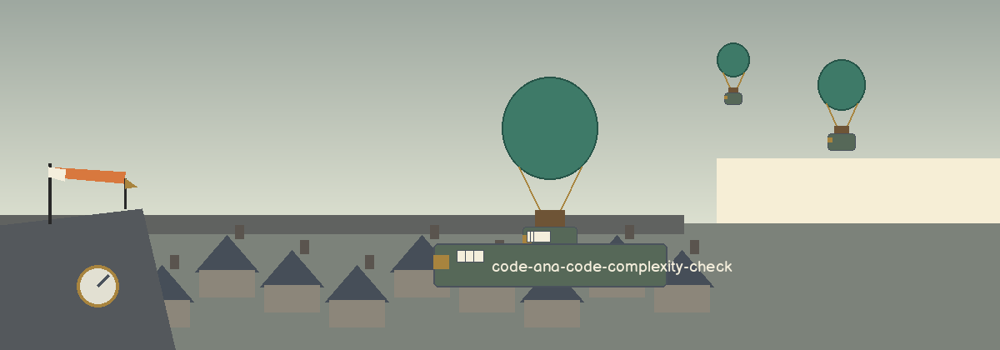

# code-ana-code-complexity-check

Analyzes Python code files and reports the cyclomatic complexity of each function, one line per function with its file and line number. Accepts a single file or a directory, which is searched recursively for .py files. With --max-complexity N the run exits with status 1 when any function exceeds N, so it can gate a script or CI step. A file that does not parse is reported as an error and also fails the run. Complexity counts 1 for entering a function, plus 1 for each if, loop, except handler, conditional expression, comprehension filter, and each extra operand in an and/or chain; nested functions are scored separately, not as part of the function that contains them.

> **Post office notice: this file could not be read.** A file that does not parse is reported as an error and also fails the run.

> **Post office notice: read the text, not only the code.** Scores print to the standard output and failures to the error output, so an exit status of 1 alone does not say whether a function ran over the limit or a file could not be parsed.

## Install
`git clone https://github.com/ShadowGuard-AI/code-ana-code-complexity-check`

## Usage
`python3 main.py <file-or-directory> [--max-complexity N]`

## Verified behavior
- A function with one `if` branch scores complexity 2.
- With `--max-complexity 1`, that same run exits 1.

## License
See LICENSE.
